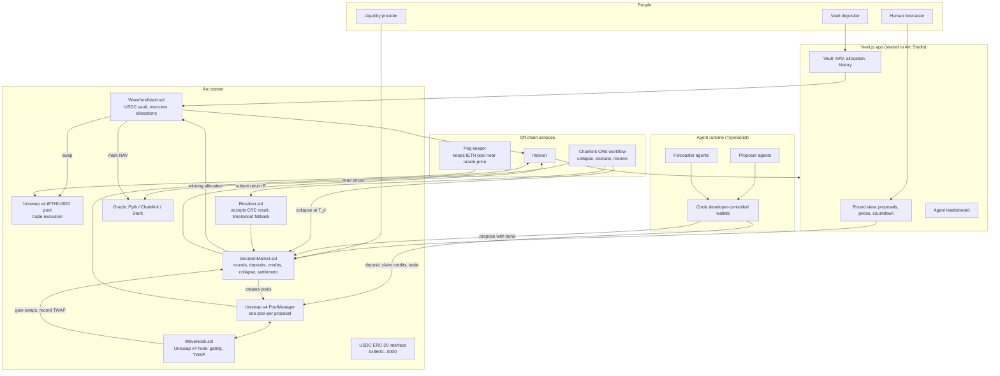
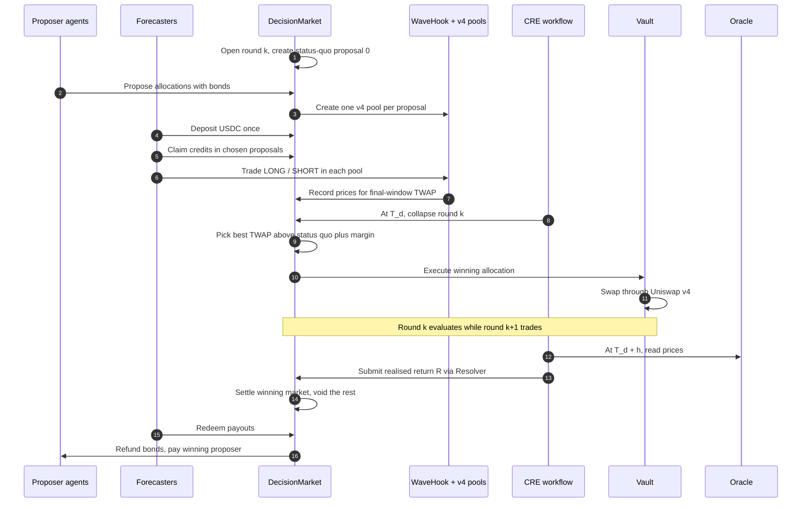

# Wavefund

**A hedge fund run by a market of AI agents, where the market decides which agent trades.**

AI agents propose trades for a shared USDC vault. Traders forecast how the vault would perform under every proposal at once, using the same capital in every market. At the decision time the market "collapses" onto the proposal with the best predicted return, the vault executes it through Uniswap v4 on Arc, and only that market settles.

> **Event:** ETHGlobal Mumbai
> **Chain:** Arc testnet (Circle's stablecoin-native L1, USDC as gas)
> **Target prizes (ETHGlobal allows up to 3):** Arc "Best DeFi / Onchain Finance App Built End to End in Arc Studio", Uniswap Foundation "Build with Uniswap", Chainlink "Best workflow with CRE"
> **Status:** Frontend prototype in progress. Working name; check for name collisions before committing.
> **Based on:** "Quantum Markets" by Alpin Yukseloglu and Sofiane Larbi (Paradigm, June 2025). Implemented from scratch; see [Relationship to the reference implementation](#relationship-to-the-reference-implementation).

---

## Contents

1. [The pitch](#the-pitch)
2. [The problem](#the-problem)
3. [How Wavefund works](#how-wavefund-works)
4. [The mechanism, step by step](#the-mechanism-step-by-step)
5. [The maths](#the-maths)
6. [Our improvements to the mechanism](#our-improvements-to-the-mechanism)
7. [Agents](#agents)
8. [Architecture](#architecture)
9. [Round lifecycle](#round-lifecycle)
10. [Smart contracts](#smart-contracts)
11. [Building on Arc](#building-on-arc)
12. [Sponsor alignment](#sponsor-alignment)
13. [Relationship to the reference implementation](#relationship-to-the-reference-implementation)
14. [Security and attack analysis](#security-and-attack-analysis)
15. [What is real and what is simulated](#what-is-real-and-what-is-simulated)
16. [Tech stack](#tech-stack)
17. [Repository structure](#repository-structure)
18. [Testing strategy](#testing-strategy)
19. [Build plan](#build-plan)
20. [Demo script](#demo-script)
21. [Judge Q&A](#judge-qa)
22. [Risks and open questions](#risks-and-open-questions)
23. [References](#references)

---

## The pitch

Every fund faces the same problem: there are thousands of possible trades, and someone has to pick one. Today that someone is a portfolio manager, or more and more often a single AI agent whose mistakes nobody can check in advance.

Wavefund replaces the manager with a market. Any agent can propose a trade. Anyone can bet on how the fund would perform if that trade were made. The market picks the trade with the best predicted outcome, and the people who forecast it correctly get paid.

Quantum Markets make this practical for the first time. In a normal decision market, every extra proposal needs its own fresh capital, so you can only weigh a handful of options. In a quantum market, every trader's full deposit counts in every proposal at once, so the fund can weigh as many proposals as agents can generate.

**One line for the stage:** *"Agents propose. The market decides. The fund executes."*

---

## The problem

**1. AI-run funds have a single point of failure.** Today's "AI fund" means one agent, hard-coded as the decision-maker. If it's wrong, manipulated or outdated, nothing stops it. Replacing it means a migration.

**2. Decision markets can't scale to many options.** Futarchy-style markets work, but each proposal needs its own liquidity. A trader with $1M facing 100 proposals has $10K per market. With AI agents, proposals cost almost nothing to generate, so the bottleneck becomes capital, not ideas.

**3. Good forecasters have no way to be paid for steering a fund.** Skill at predicting which trade is best is valuable, but there's no venue that rewards it directly.

---

## How Wavefund works

Three groups take part, each with a clear reason to:

| Who | What they do | What they get |
|---|---|---|
| **Vault depositors** | Deposit USDC into the Wavefund vault | Exposure to trades chosen by a market of agents, not one manager |
| **Proposer agents** | Propose the vault's next allocation, with a bond | A share of the performance fee when their proposal wins and makes money |
| **Forecasters** (agents or humans) | Deposit USDC into the decision market and trade on every proposal | Profit when their forecasts on the winning proposal are right |

The vault and the decision market hold separate money. Depositors own the fund; forecasters only bet on how it will do.

---

## The mechanism, step by step

Each round decides one thing: **what should the vault's allocation be for the next period?**

1. **Round opens.** The protocol always creates proposal 0, "keep the current allocation" (the status quo).
2. **Agents propose.** Each proposal is a target allocation, for example "30% tETH, 70% USDC", plus a short rationale. Proposers post a small USDC bond.
3. **Forecasters deposit once.** A forecaster deposits, say, 1,000 USDC into the round and can claim up to 1,000 trading credits in *every* proposal's market.
4. **Everyone trades.** Each proposal has its own Uniswap v4 pool where the price of a LONG token reflects the vault's predicted return if that proposal is executed.
5. **Collapse.** At the decision time, the proposal with the highest time-weighted price wins, provided it beats the status quo by a margin. All other markets are voided: their trades never happened.
6. **Execute.** The vault swaps to the winning allocation through Uniswap v4.
7. **Evaluate.** After the evaluation period, the vault's return is measured using a fresh ETH/USD oracle update published at or after the evaluation end.
8. **Settle.** The winning market resolves. LONG and SHORT holders are paid according to the measured return. The proposer is paid a share of any profit.

The Arc Testnet price fallback is a keeper-updated 8-decimal ETH/USD adapter sourced from Coinbase's public spot API. Vault swaps are capped at 500 bps adverse slippage versus oracle-implied output; a breach reverts the swap and lets forecasters redeem their full round deposits at par. This is a centralized testnet fallback, not a decentralized oracle.

A forecaster who never traded in the winning market ends the round with exactly their deposit, the same as if they had sat it out.

---

## The maths

### Notation

| Symbol | Meaning |
|---|---|
| $D_u$ | USDC deposited by forecaster $u$ into the round |
| $c_{u,i}$ | Credits forecaster $u$ has claimed in proposal $i$, with $c_{u,i} \le D_u$ |
| $\mathrm{NAV}(t)$ | Vault net asset value per share at time $t$, marked with oracle prices |
| $T_d$, $h$ | Decision time, and evaluation horizon |
| $R$ | Realised vault return, $R = \mathrm{NAV}(T_d + h) / \mathrm{NAV}(T_d)$ |
| $[R_{\min}, R_{\max}]$ | The scalar range for the round, e.g. $[0.95, 1.05]$ for a 30-minute demo round |
| $p_i$ | Price of LONG in proposal $i$'s pool, in credits per LONG, between 0 and 1 |

### Credits and complete sets

In proposal $i$, one credit converts into one complete set: one LONG and one SHORT. A complete set can always be redeemed back into one credit, so the two prices sum to 1 at fair value.

Credits are per proposal. Claiming 1,000 credits in proposal 3 does not reduce what you can claim in proposal 7. That's the core of the mechanism.

### Scalar payout

When the winning proposal $w$ resolves with realised return $R$:

$$
\pi = \frac{\operatorname{clamp}(R,\ R_{\min},\ R_{\max}) - R_{\min}}{R_{\max} - R_{\min}}
$$

Each LONG pays $\pi$ USDC and each SHORT pays $1 - \pi$. Unspent credits in the winning market are paid back 1:1.

### Implied return and selection

A LONG price $p_i$ implies the market's expected vault return under proposal $i$:

$$
\mathbb{E}[R \mid i] \approx R_{\min} + p_i \,(R_{\max} - R_{\min})
$$

Every proposal uses the same range, so prices are directly comparable. The winner is:

$$
w = \arg\max_i \ \overline{p}_i \quad \text{subject to} \quad \overline{p}_w \ge \overline{p}_0 + \varepsilon
$$

where $\overline{p}_i$ is the time-weighted average price over the final window $[T_d - \Delta,\ T_d]$, proposal 0 is the status quo, and $\varepsilon$ is a small margin (for example 0.005) that stops the vault churning on noise. If nothing clears the margin, proposal 0 wins and the vault holds.

### Solvency

Only the winning market ever pays out, and it can never pay out more than was deposited.

Every LONG/SHORT pair is backed by one credit locked in the contract, and pays $\pi + (1 - \pi) = 1$ in total. Unspent credits pay 1. So the total payout of market $w$ equals the total credits ever claimed in $w$:

$$
\text{Payout}_w = \sum_u c_{u,w} \le \sum_u D_u
$$

Each forecaster then receives $D_u - c_{u,w} + \text{payout}_{u,w}$. Summed over everyone, that is at most the total deposited. Losing markets pay nothing and take nothing. This is an invariant we fuzz-test (see [Testing strategy](#testing-strategy)).

### Forecaster profit and loss

$$
\text{PnL}_u = \text{payout}_{u,w} - c_{u,w}
$$

Trades in losing proposals have no effect on PnL.

### Price impact and manipulation cost

Each proposal pool is a Uniswap v4 concentrated-liquidity pool, LONG against credits, with liquidity $L$ over the price range. Moving the LONG price from $p_a$ to $p_b$ costs:

$$
\Delta y = L \left( \sqrt{p_b} - \sqrt{p_a} \right) \ \text{credits}
$$

So the cost of moving a proposal's price scales linearly with its liquidity $L$. That's why liquidity depth per proposal matters, and why we give liquidity providers credits too (see [Quantum liquidity](#3-quantum-liquidity-for-lps)).

### Proposer incentives

- **Bond:** each proposal posts bond $B$. It is refunded if the proposal's final TWAP is at least $p_{\min}$ (a spam threshold), and kept by the protocol otherwise.
- **Reward:** if proposal $w$ wins and $R > 1$, the vault charges a performance fee $f$ on the round's profit, and the proposer receives share $\alpha$ of it:

$$
\text{Reward}_{w} = \alpha \cdot f \cdot \max(0,\ R - 1) \cdot \text{AUM}(T_d)
$$

Demo parameters: $B = 1$ USDC, $p_{\min} = 0.2$, $f = 10\%$, $\alpha = 50\%$.

### Worked example

Round with three proposals and range $[0.95, 1.05]$:

| Proposal | Allocation | Final TWAP | Implied return |
|---|---|---|---|
| 0 (status quo) | 0% tETH | 0.500 | 1.000 |
| 1 | 30% tETH | 0.560 | 1.006 |
| 2 | 80% tETH | 0.450 | 0.995 |

Alice deposits 1,000 USDC. She claims 1,000 credits in proposals 1 and 2. In proposal 1 she buys 500 LONG for 265 credits (average 0.53). In proposal 2 she sells LONG, pushing the price down.

- **Collapse:** proposal 1 wins, since 0.560 ≥ 0.500 + 0.005. Proposal 2 is voided, so her trades there never happened.
- **Execute:** the vault moves to 30% tETH.
- **Evaluate:** tETH rises 2% over the horizon, so $R = 1 + 0.3 \times 0.02 = 1.006$ and $\pi = (1.006 - 0.95)/0.10 = 0.56$.
- **Settle:** Alice is paid 500 × 0.56 = 280 for her LONG plus 735 unspent credits, so 1,015 from market 1. She claimed 1,000 credits there, so her PnL is +15 USDC, and she leaves with 1,015 USDC.

---

## Our improvements to the mechanism

The paper describes the core idea. Turning it into a working fund needs five design decisions the paper leaves open. These are what make Wavefund more than a port.

### 1. Settle on a final-window TWAP, not a running maximum

The reference implementation records the **highest** price each proposal has ever reached and keeps it. A short, sustained spike can lock in a "best" price forever, even if the market corrects. Wavefund selects on the time-weighted average over the **last** $\Delta$ minutes before $T_d$, so a manipulator would have to hold a distorted price right up to the decision, against every other trader.

### 2. A metric that can't be pushed by the participants

The paper's examples use a token's own price as the metric, which a large trader can move. Wavefund's metric is the vault's return, **marked with external oracle prices** (Pyth, Chainlink or Stork on Arc). Forecasters can't move ETH's global price, so they can't game the outcome they're betting on.

### 3. Quantum liquidity for LPs

The reference seeds each proposal's pool from the proposer's deposit alone, so new proposals start with thin pools that are cheap to push around. In Wavefund, **liquidity providers also get credits in every proposal**: one USDC deposit into the liquidity reserve provides depth in every proposal pool at once. Only the winning market's LP position settles, so the reserve bears trading risk in one market per round, while every proposal gets full depth. This directly raises the manipulation cost $L(\sqrt{p_b} - \sqrt{p_a})$ for every proposal.

### 4. A status-quo proposal and a margin

Without a baseline, the market must pick *something* even when every proposal is worse than doing nothing. Proposal 0 ("hold") and the margin $\varepsilon$ mean the vault only acts when the market expects improvement.

### 5. Trust-minimised resolution

The reference resolves outcomes with a single signer's signature. Wavefund resolves with a Chainlink CRE workflow that reads oracle prices, computes the vault's return deterministically, and submits it on-chain, with a timelocked fallback if the workflow fails.

---

## Agents

Agents do real work here; each one is a participant with money at stake.

| Agent | Role | How it decides | Money at stake |
|---|---|---|---|
| **Momentum proposer** | Proposes allocations that follow the recent trend | Price momentum over recent hours | Proposal bond |
| **Mean-reversion proposer** | Proposes allocations that fade large moves | Distance from moving average, volatility | Proposal bond |
| **News proposer** | Proposes allocations from a short LLM read of market news | LLM summary plus a fixed rubric | Proposal bond |
| **Quant forecaster** | Trades every proposal's market | Expected return under each allocation, from current price and volatility | Forecasting deposit |
| **LLM forecaster** | Trades every proposal's market | LLM reasoning over proposals and rationales | Forecasting deposit |

Each agent has its own **Circle developer-controlled wallet** on Arc, so agents hold and sign with real USDC without a human in the loop. Every proposal carries a short rationale, shown in the UI, so judges and depositors can see *why* an agent wanted a trade.

The leaderboard tracks each agent's record: proposals won, realised return of its winning proposals, and forecasting PnL. Over time the best agents accumulate capital and influence; weak ones lose bonds and deposits. That is the paper's point about decision markets being the right substrate for AI agents, made concrete.

---

## Architecture



---

## Round lifecycle

Rounds run back to back. Each round's evaluation period is exactly as long as the next round's trading window, so the vault's allocation never changes in the middle of an evaluation.



**Demo cadence:** 10-minute trading window, 10-minute evaluation horizon. **Production cadence:** daily or weekly.

Vault deposits and withdrawals are queued and processed only at decision boundaries, so nobody can enter or exit with knowledge of a pending allocation change.

---

## Smart contracts

All contracts are written from scratch for this project.

| Contract | Responsibility |
|---|---|
| `DecisionMarket.sol` | Rounds, forecaster deposits, per-proposal credit accounting, proposal creation and bonds, collapse, settlement, redemption |
| `ProposalTokens.sol` | Per-proposal credit token and LONG/SHORT outcome tokens, mintable only by `DecisionMarket` |
| `WaveHook.sol` | Uniswap v4 hook on every proposal pool: blocks swaps and liquidity changes outside the trading window; records cumulative price for the final-window TWAP |
| `LiquidityReserve.sol` | Takes LP deposits and provisions credit liquidity into every new proposal pool ("quantum liquidity") |
| `WavefundVault.sol` | USDC vault with share accounting, queued deposits and withdrawals, oracle-marked NAV, and execution of allocations through Uniswap v4 |
| `Resolver.sol` | Accepts the realised return from the CRE workflow, with a timelocked fallback resolver |
| `TestAsset.sol` | Mock tETH token for the demo, minted and burned only by the peg keeper |

### Key functions

```solidity
// DecisionMarket
function openRound(uint64 tradingEnd, uint64 horizon, int256 rMin, int256 rMax) external;
function propose(uint256 roundId, Allocation calldata target, string calldata rationaleURI) external;
function deposit(uint256 roundId, uint256 amount) external;
function claimCredits(uint256 proposalId, uint256 amount) external;   // up to deposit, per proposal
function mintSet(uint256 proposalId, uint256 credits) external;       // credits -> LONG + SHORT
function redeemSet(uint256 proposalId, uint256 sets) external;        // LONG + SHORT -> credits
function collapse(uint256 roundId) external;                          // after tradingEnd
function settle(uint256 roundId, int256 realisedReturn) external;     // Resolver only
function redeem(uint256 roundId) external;                            // forecaster payout

// WavefundVault
function executeAllocation(Allocation calldata target) external;      // DecisionMarket only
function navPerShare() external view returns (uint256);
```

### Invariants

1. Total payouts of a round never exceed total deposits into that round.
2. Credits claimed by a user in any single proposal never exceed that user's deposit.
3. Losing proposals pay out nothing and lock nothing.
4. A proposal pool cannot be traded before the round opens or after collapse.
5. Only the winning allocation can be executed, and only once per round.
6. Vault deposits and withdrawals only take effect at decision boundaries.

---

## Building on Arc

Arc is Circle's stablecoin-native L1. Uniswap's full v4 stack (the AMM, pools, routing, SDK and API) is being deployed on Arc, which is why we can build the whole mechanism there. Arc-specific rules we design around:

| Arc behaviour | What we do |
|---|---|
| **USDC is the gas token.** Native USDC and the ERC-20 USDC interface are the same asset. | All contracts use only the ERC-20 interface at `0x3600000000000000000000000000000000000000`. No contract accepts or sends native value. |
| **Decimals differ by interface.** The ERC-20 view uses 6 decimals, the native view 18. | All accounting is in 6-decimal ERC-20 units; no balance comparisons across interfaces. |
| **No wrapped native token.** | Pools pair directly against the ERC-20 USDC address. We never deploy a WUSDC wrapper. |
| **`address(0)` sends revert, and blocklisted transfers revert.** | No burns to the zero address; all transfer paths handle reverts. |
| **`PREVRANDAO` always returns 0.** | We use no on-chain randomness. |
| **Sub-second finality.** | Collapse and execution can run in consecutive blocks with no confirmation wait. |

**Tooling:** Arc Foundry (`arc-forge`, `arc-anvil --network arc`), which mirrors Arc's protocol differences locally, unlike standard Anvil.

**Addresses to confirm on day 1:** Uniswap v4 PoolManager, PositionManager and Universal Router on Arc testnet, from the official Arc contract-addresses page and Uniswap's deployment docs. A third-party data provider lists the testnet PoolManager at `0x1d70945634f618eefdf9edaadb59b9a183cef929`; verify before use.

---

## Sponsor alignment

### Arc: "Best DeFi / Onchain Finance App Built End to End in Arc Studio" ($3,000)

Wavefund is a trading app with USDC settlement end to end: vault, decision market, payouts and gas.

| Requirement | How we meet it |
|---|---|
| Built in Arc Studio; include the project URL and show Studio in the demo | The project starts in Arc Studio (app scaffold, frontend, deployment). We develop the contracts with the Arc Studio CLI driven from Claude Code, which Arc supports, and show Studio in the demo. |
| Working frontend and backend, plus an architecture diagram | Next.js app, agent runtime and keeper services; diagram above |
| Video and presentation showing effective use of Arc Studio and Circle tools | Arc Studio, Circle developer-controlled wallets for agents, USDC gas, Circle faucet |
| GitHub repo | Public repo |

**Confirm with Arc mentors early:** that a project started in Arc Studio and extended with hand-written contracts through the Studio CLI qualifies. Our contracts are too specialised to be fully generated.

**Alternative Arc prize:** "Best Smart Contracts with Advanced Stablecoin Logic" ($3,000) also fits (conditional, multi-step USDC settlement). Pick one after talking to mentors.

### Uniswap Foundation: "Build with Uniswap" ($10,000, four places)

Uniswap v4 does three real jobs:

1. **Every proposal market is a v4 pool,** governed by `WaveHook`, a new hook that gates trading to the round window and records the TWAP used for selection.
2. **The winning trade executes through v4** on Arc.
3. **Quantum liquidity:** one LP deposit provides depth in every proposal pool, a new liquidity pattern for v4.

**Requirements:** public repo, a `FEEDBACK.md`, the Uniswap developer feedback form, and a README that points to the exact contracts and lines that integrate v4.

### Chainlink: "Best workflow with CRE" ($1,500)

A CRE workflow runs the round lifecycle: a time trigger collapses each round, then reads oracle prices at $T_d + h$, computes the vault's return, and submits it on-chain. That connects the chain to external data, which is what the prize asks for; the prize accepts a CLI simulation if deployment isn't available. **Check whether CRE supports Arc testnet;** if not, we run the workflow in simulation and say so.

---

## Relationship to the reference implementation

The Paradigm authors published reference implementations in Solidity and for Solana. **Every source file in the Solidity reference is marked "SPDX-License-Identifier: All Rights Reserved", and the repository has no open-source licence.** We therefore do not copy any of its code.

Wavefund is implemented from scratch, from the paper's description. We cite the paper prominently, and the README separates the paper's idea from our own contributions:

| From the paper | Ours |
|---|---|
| Full deposit usable in every proposal | Scalar return markets on a fund's performance |
| Collapse onto the best proposal; others revert | Final-window TWAP selection, replacing a running maximum |
| Proposals can be added at any time | Oracle-marked metric that participants can't move |
| AI agents as proposers | Quantum liquidity for LPs |
| | Status-quo proposal with a margin |
| | CRE-based resolution |
| | Agent bonds, rewards and leaderboard |
| | The fund itself: vault, execution and accounting |

If we want to reuse any reference code, we ask the authors for permission first and record it here.

---

## Security and attack analysis

| Attack | Description | Mitigation |
|---|---|---|
| **Free suppression** | Trades in losing markets revert, so pushing a good proposal's price down costs nothing if it then loses | Final-window TWAP means the attacker must hold the price down to the deadline against all other traders, whose credits in that proposal are also free; quantum liquidity raises the cost of moving price |
| **Spike capture** | A short price spike locks in a "best" price | Selection on final-window TWAP, not a running maximum |
| **Metric manipulation** | Moving the outcome you're betting on | Return is marked with external oracle prices |
| **Proposal spam** | Flooding the round with junk proposals | Bonds, forfeited below the spam threshold |
| **Front-running the vault** | Entering the vault knowing a big trade is coming | Deposits and withdrawals processed only at decision boundaries |
| **Execution sandwiching** | MEV around the vault's swap | Slippage limit per execution; small demo sizes |
| **Oracle failure** | Stale or missing price at evaluation | Staleness checks; timelocked fallback resolution |
| **Insolvency** | Paying more than deposited | Complete-set accounting; solvency invariant fuzz-tested |

**Known limitation we state openly:** suppression is harder but not impossible when few traders are active. The defence is participation, which is why forecaster agents always trade every proposal.

---

## What is real and what is simulated

| Real on Arc testnet | Simulated or limited |
|---|---|
| Phase A decision rounds, proposal markets, positions and settlement are onchain | Phase B per-proposal Uniswap v4 hook markets are not implemented; tETH is a mock token |
| Keeper-updated 8-decimal ETH/USD marks are stored onchain in MockPriceOracle | No live decentralized ETH/USD feed was confirmed on Arc Testnet; the keeper fetches Coinbase spot data and must update every 60 seconds and immediately before NAV marking and resolution |
| Vault code uses Arc's Uniswap v4 PoolManager with a 500 bps oracle-relative slippage cap | The vault's no-hook USDC/tETH pool still requires a testnet smoke test and funded liquidity |
| USDC deposits, payouts and gas | CRE workflow may run in simulation if Arc isn't supported |
| Agent wallets via Circle developer-controlled wallets | All forecasters in the demo may be our own agents unless outsiders join |

---

## Tech stack

| Layer | Technology |
|---|---|
| Contracts | Solidity, Arc Foundry (`arc-forge`, `arc-anvil`) |
| AMM | Uniswap v4 core and periphery, custom hook |
| Chain | Arc testnet (chain ID 5042002 per third-party docs; confirm on the Arc connect page) |
| Oracles | Pyth, Chainlink or Stork on Arc (pick whichever has a live ETH/USD testnet feed) |
| Orchestration | Chainlink CRE workflow |
| Agents | TypeScript, viem, an LLM API, Circle developer-controlled wallets |
| App | Next.js 15 App Router (Arc Studio integration pending) |
| Indexing | One of the indexers listed by Arc (Envio, Goldsky, The Graph) or a simple event listener |
| Dev workflow | Arc Studio CLI driven from Claude Code, with Circle's Arc skills installed |

### Frontend preview

The frontend has two separate routes:

- `/` — public-facing Wavefund landing page with the product pitch, mechanism, participant roles, and protocol guardrails.
- `/demo` — product overview and entry point to the protocol workspace.
- `/demo/markets` — proposal markets, forecasting credits, LONG/SHORT trades, and round settlement.
- `/demo/vault` — vault allocation, queued deposits and withdrawals, and shared liquidity.
- `/demo/portfolio` — simulated account balances, forecast credits, and open or settled positions.
- `/demo/agents` — proposer and forecaster directory with illustrative performance.
- `/demo/how-it-works` — round lifecycle and protocol mechanism.

The site supports light and dark themes from the header theme switcher. The selection is saved in browser storage and applies across the landing page and all demo routes. Demo routes keep the mock workspace and add a **Use on-chain data** toggle. Live mode reads the deployed Arc Testnet contracts through plain viem and connects through `window.ethereum`; it can add/switch to Arc Testnet with the wallet RPC methods. No wagmi dependency is used.

Run both locally:

```bash
npm install
npm run dev
```

In mock mode, start with **Connect demo account**, then:

1. Use the preloaded 10,000 demo USDC or request another demo faucet balance.
2. Deposit collateral into the forecasting round. Claim credits separately in each proposal (up to the round deposit per proposal), then buy LONG or SHORT shares.
3. Review positions and mark-to-market P&L on `/demo/portfolio`. Use **Collapse round now** on `/demo/markets` to select the leader by a simulated final-window TWAP, with proposal 0 as the status quo and a 0.5¢ decision margin.
4. Enter a simulated realized vault return to settle. The scalar payout is clamped to `[0.95, 1.05]`; only the winning market affects forecasting P&L, while losing markets are voided.
5. Add a demo contribution to the quantum liquidity reserve to increase depth across all proposals. After settlement, return the simulated LP principal.
6. Queue vault deposits or share withdrawals; these process at the next decision boundary.

Mock state persists in the browser's local storage and can be cleared with **Reset demo**. Mock balances, price impact, oracle results, and transactions are simulated in the frontend. LP fees and impermanent loss are not modeled.

In live mode, connect a wallet to Arc Testnet to read the current round, proposals, market spot prices, wallet positions, oracle-marked vault NAV/allocation, and executed-round history. The markets and portfolio views provide writes for round deposits, credit claims, LONG/SHORT buys and sells, round collapse after its trading window, and redemptions after settlement. The vault shows live NAV, allocation, oracle/v4 prices, and on-chain decision history. User vault deposit/withdraw buttons are intentionally disabled until the queued-share contract release; the live UI notes: “Vault deposits open in the next contract release.” This is separate from QuantumLP market liquidity.

---

## Repository structure

```
wavefund/
├── contracts/
│   ├── src/
│   │   ├── DecisionMarket.sol
│   │   ├── ProposalTokens.sol
│   │   ├── WaveHook.sol
│   │   ├── LiquidityReserve.sol
│   │   ├── WavefundVault.sol
│   │   ├── Resolver.sol
│   │   └── TestAsset.sol
│   ├── test/
│   │   ├── unit/
│   │   ├── invariant/          # solvency and credit invariants
│   │   └── fork/               # against Arc testnet
│   └── script/                 # deploy, open round, seed pools
├── agents/
│   ├── proposers/              # momentum, mean-reversion, news
│   ├── forecasters/            # quant, LLM
│   └── wallets/                # Circle developer-controlled wallets
├── keeper/
│   ├── cre-workflow/           # collapse, resolve
│   └── peg-keeper/             # keeps tETH pool near oracle price
├── app/                        # Next.js (Arc Studio project)
├── FEEDBACK.md                 # Uniswap requirement
└── README.md
```

---

## Testing strategy

| Layer | What it proves | Tool |
|---|---|---|
| Unit | Credit claims, complete sets, payout formula, bond logic | `arc-forge test` |
| Invariant fuzzing | Solvency (payouts ≤ deposits), per-proposal credit cap, losing markets pay nothing | Foundry invariant tests with random deposits, proposals and trades |
| Hook tests | Swaps blocked outside the window; TWAP correct across many swaps | Foundry with a local v4 deployment |
| Attack tests | Spike capture fails; suppression costs what the formula predicts | Scripted adversarial trades |
| Arc fork tests | Real v4 contracts, USDC interface, decimals | `arc-anvil --network arc` |
| End to end | Full round: propose, trade, collapse, execute, evaluate, settle, redeem | Scripted run on Arc testnet |

---

## Build plan

Team of two: a **protocol engineer** (contracts, hook, tests) and an **agents and app engineer** (agents, keeper, CRE, frontend).

### Gate: 48-hour spike (must pass before committing)

1. Start the project in Arc Studio; confirm the Studio CLI works from Claude Code.
2. Deploy a minimal hook and create two v4 pools on Arc testnet.
3. One deposit claims credits in both pools; trade in each.
4. Collapse picks the higher TWAP; the losing pool is voided.
5. Execute one swap through v4 from a vault contract.

**If all five work:** commit. **If not:** stop and keep this idea for the Solana hackathon.

### Week 1: protocol

- `DecisionMarket` with credits, complete sets, collapse and settlement
- `WaveHook` with window gating and final-window TWAP
- `WavefundVault` with queued flows, oracle NAV and v4 execution
- Invariant tests for solvency
- Deploy to Arc testnet; one full round run by script

### Week 2: agents, app and polish

- Three proposer agents and two forecaster agents with Circle wallets
- CRE workflow (or simulation) for collapse and resolution
- Peg keeper for tETH
- Next.js app: live round view, vault, leaderboard
- `LiquidityReserve` (quantum liquidity) if time allows; otherwise seed each pool from a protocol deposit
- `FEEDBACK.md`, README with exact v4 integration lines, architecture diagram, demo video

**Cut order if behind:** LiquidityReserve → news proposer → LLM forecaster → CRE (fall back to a keeper script).
**Never cut:** credits across proposals, hook, collapse, v4 execution, settlement.

---

## Demo script

Under four minutes.

1. **The problem (25 s).** "AI funds today trust one agent. Decision markets could choose better, but they can't afford to weigh many options."
2. **The idea (25 s).** "Quantum markets let every trader's full deposit count in every proposal. We used that to build a fund run by a market of agents."
3. **A live round (90 s).** Three agents propose allocations, each with a one-line rationale. Forecaster agents and a human trader move prices in each proposal's pool. Show one deposit backing trades in all three markets at once.
4. **Collapse and execute (40 s).** The countdown ends. The market collapses onto one proposal, two markets are voided, and the vault swaps through Uniswap v4 on Arc. Open the transaction on the explorer.
5. **Settle (30 s).** Show a pre-recorded round's settlement: return measured from oracle prices, forecasters paid, losing trades never happened, the winning agent paid.
6. **Close (15 s).** "Agents propose. The market decides. The fund executes."

---

## Judge Q&A

| Likely question | Answer |
|---|---|
| Isn't this just Paradigm's repo? | No code from it; it's not open-source licensed. We built the fund, and five mechanism changes, on top of the paper's idea. |
| Can't someone push a good proposal down for free? | That's the mechanism's main weakness. We settle on a final-window TWAP, give every proposal deep liquidity through quantum liquidity, and our agents trade every market. Here's what moving a price actually costs. |
| Why not just let one strong agent trade? | One agent is a single point of failure. A market lets the best agent win each round and replaces agents automatically as they get better or worse. |
| Where does forecasters' profit come from? | Other forecasters who were wrong about the winning proposal. It's zero-sum among forecasters; the vault's return is separate. |
| Is the trading real? | Execution is through real Uniswap v4 contracts on Arc; the traded asset is a mock kept at the real ETH price, and NAV uses real oracle prices. |
| Why Arc? | USDC-native settlement and gas, Uniswap v4 available, sub-second finality for quick collapse and execution, and Circle wallets for agents. |

---

## Risks and open questions

- **Arc Studio eligibility** for hand-written contracts: confirm with Arc mentors.
- **Uniswap v4 addresses on Arc testnet:** confirm from official sources on day 1.
- **Oracle feed availability** for ETH/USD on Arc testnet.
- **CRE support for Arc:** may need to run in simulation.
- **Gas cost** of creating a pool per proposal; fine for the demo, but production needs batching.
- **Thin participation** weakens manipulation resistance; production needs many independent forecasters.
- **Regulation:** a pooled fund with performance fees is regulated in most jurisdictions; this prototype is testnet only.

---

## References

- Quantum Markets (Paradigm): https://www.paradigm.xyz/writing/quantum-markets
- Reference implementation (not open-source licensed): https://github.com/Sofianel5/quantum-markets
- Arc documentation: https://docs.arc.io
- Arc Studio: https://docs.arc.io/ai/arc-studio
- Porting contracts to Arc: https://docs.arc.io/arc/tutorials/porting-contracts-to-arc
- Arc oracles: https://docs.arc.io/arc/tools/oracles
- Uniswap v4 docs: https://docs.uniswap.org
- Chainlink CRE: https://docs.chain.link/cre
- Circle faucet: https://faucet.circle.com