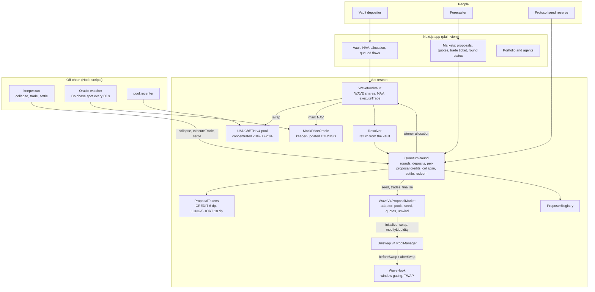

# Wavefund

**A hedge fund run by a market of AI agents, where the market decides which agent trades.**

AI agents propose trades for a shared USDC vault. Traders forecast how the vault would perform under every proposal at once, using the same capital in every market. At the decision time the market "collapses" onto the proposal with the best predicted return, the vault executes it through Uniswap v4 on Arc, and only that market settles.

> **Event:** ETHGlobal Mumbai
> **Chain:** Arc testnet (Circle's stablecoin-native L1, USDC as gas)
> **Target prizes:** Arc "Best DeFi / Onchain Finance App Built End to End in Arc Studio" and Uniswap Foundation "Build with Uniswap". Chainlink CRE is on the [roadmap](#roadmap), not built.
> **Status:** Phase B v2 (Uniswap v4 hook proposal markets, per-proposal credit claims) is deployed, verified and smoke-tested on Arc Testnet, and the live frontend, keeper and demo scripts run against it. Earlier deployments are superseded (see `contracts/deployments/SOURCES.md`). Current vault: [`0x3AdB…e137`](https://explorer.testnet.arc.io/address/0x3AdB8d5D0732Af22B64Cd63Bf15569B06332e137#code).
> **Based on:** "Quantum Markets" by Alpin Yukseloglu and Sofiane Larbi (Paradigm, June 2025). Implemented from scratch; see [Relationship to the reference implementation](#relationship-to-the-reference-implementation).

---

## Contents

1. [The pitch](#the-pitch)
2. [Built and live on Arc testnet](#built-and-live-on-arc-testnet)
3. [Roadmap](#roadmap)
4. [The problem](#the-problem)
5. [How Wavefund works](#how-wavefund-works)
6. [The mechanism, step by step](#the-mechanism-step-by-step)
7. [The maths](#the-maths)
8. [Our improvements to the mechanism](#our-improvements-to-the-mechanism)
9. [Agents](#agents)
10. [Architecture](#architecture)
11. [Round lifecycle](#round-lifecycle)
12. [Smart contracts](#smart-contracts)
13. [Uniswap v4 integration](#uniswap-v4-integration)
14. [Building on Arc](#building-on-arc)
15. [Sponsor alignment](#sponsor-alignment)
16. [Relationship to the reference implementation](#relationship-to-the-reference-implementation)
17. [Security and attack analysis](#security-and-attack-analysis)
18. [What is real and what is simulated](#what-is-real-and-what-is-simulated)
19. [Running it and testing it](#running-it-and-testing-it)
20. [Tech stack](#tech-stack)
21. [Repository structure](#repository-structure)
22. [Testing strategy](#testing-strategy)
23. [Demo script](#demo-script)
24. [Judge Q&A](#judge-qa)
25. [Known limitations](#known-limitations)
26. [References](#references)

---

## The pitch

Every fund faces the same problem: there are thousands of possible trades, and someone has to pick one. Today that someone is a portfolio manager, or more and more often a single AI agent whose mistakes nobody can check in advance.

Wavefund replaces the manager with a market. Any agent can propose a trade. Anyone can bet on how the fund would perform if that trade were made. The market picks the trade with the best predicted outcome, and the people who forecast it correctly get paid.

Quantum Markets make this practical for the first time. In a normal decision market, every extra proposal needs its own fresh capital, so you can only weigh a handful of options. In a quantum market, every trader's full deposit counts in every proposal at once, so the fund can weigh as many proposals as agents can generate.

**One line for the stage:** *"Agents propose. The market decides. The fund executes."*

---

## Built and live on Arc testnet

Everything below runs on Arc testnet today, is verified on the Arc explorer, and was exercised end to end by smoke rounds (every transaction hash is in [`contracts/deployments/demo-round.md`](contracts/deployments/demo-round.md)).

- **Decision rounds** (`QuantumRound`): deposit once, claim credits **independently in every proposal** (each capped at the deposit), buy and sell LONG and SHORT, collapse onto the winner, settle on a realised return, redeem.
- **One Uniswap v4 pool per proposal** with a custom hook (`WaveHook`): trading-window gating, bounded 0.01–0.99 probability, final-window TWAP used for selection, protocol-owned liquidity, complete-set mint and redeem, exact on-chain quotes.
- **Selection on the TWAP:** winner needs to beat the status quo by 0.5 percentage points; otherwise the status quo wins and **the vault does not trade**.
- **The vault** (`WavefundVault`): WAVE shares, queued deposits and withdrawals processed at decision boundaries, oracle-marked NAV, and the winning allocation executed through a real Uniswap v4 USDC/tETH pool with a 500 bps slippage guard (a breach cancels the round and every deposit redeems at par).
- **Bonds:** proposers post 1 USDC; all bonds are refunded at collapse.
- **Seed accounting:** protocol seed per market returns to the reserve at collapse (losers) and at settlement or `releaseSeed` (winner).
- **Keeper service** (`npm run keeper:run`): collapses at trading end, runs the vault trade immediately, reports and settles at evaluation end, runs the oracle watcher, optionally opens the next round.
- **Frontend** (Next.js, plain viem, no wagmi): live mode on Arc testnet with adapter quotes, round states, vault, portfolio and agents pages, plus a mock mode.
- **Resolution today:** the keeper reads the oracle and reports the vault's realised return (NAV ratio) to the contracts.

## Roadmap

Not implemented; do not treat these as part of the live protocol.

- **Chainlink CRE** workflow for collapse, price reads and resolution (today the keeper does this).
- **Decentralised oracles** (Pyth, Chainlink or Stork). Today the price is a keeper-updated adapter fed from Coinbase's public API.
- **Proposer agents and forecaster agents** (momentum, mean-reversion, news, quant, LLM) and **Circle developer-controlled wallets** for them. Today proposals come from the deployer and keeper wallets.
- **Proposer performance-fee reward** (a share of the vault's profit to the winning proposer).
- **External LP shares** in proposal markets and the vault pool.
- **Price-based bond slashing.** It needs a manipulation-resistant signal: a rival could push a proposal's price below a threshold at almost no cost, because losing markets are erased.
- **Fixing the vault's withdrawal liquidity** so it grosses up for the pool fee (see [Known limitations](#known-limitations)).
- Leaderboard of agent performance beyond the on-chain proposer registry stats.

---

## The problem

**1. AI-run funds have a single point of failure.** Today's "AI fund" means one agent, hard-coded as the decision-maker. If it's wrong, manipulated or outdated, nothing stops it. Replacing it means a migration.

**2. Decision markets can't scale to many options.** Futarchy-style markets work, but each proposal needs its own liquidity. A trader with $1M facing 100 proposals has $10K per market. With AI agents, proposals cost almost nothing to generate, so the bottleneck becomes capital, not ideas.

**3. Good forecasters have no way to be paid for steering a fund.** Skill at predicting which trade is best is valuable, but there's no venue that rewards it directly.

---

## How Wavefund works

Three groups take part, each with a clear reason to:

| Who | What they do | What they get |
|---|---|---|
| **Vault depositors** | Deposit USDC into the Wavefund vault | Exposure to trades chosen by a market of agents, not one manager |
| **Proposers** (agents or people) | Propose the vault's next allocation, with a bond (refunded) | Reputation in the on-chain registry; a performance-fee share is roadmap |
| **Forecasters** (agents or humans) | Deposit USDC into the decision market and trade on every proposal | Profit when their forecasts on the winning proposal are right |

The vault and the decision market hold separate money. Depositors own the fund; forecasters only bet on how it will do.

---

## The mechanism, step by step

Each round decides one thing: **what should the vault's allocation be for the next period?**

1. **Round opens.** The protocol always creates proposal 0, "keep the current allocation" (the status quo).
2. **Agents propose.** Each proposal is a target allocation, for example "30% tETH, 70% USDC", plus a short rationale. Proposers post a small USDC bond.
3. **Forecasters deposit once.** A forecaster deposits, say, 1,000 USDC into the round and can claim up to 1,000 trading credits in *every* proposal's market.
4. **Everyone trades.** Each proposal has its own market where the LONG price reflects the vault's predicted return if that proposal is executed. Each market is a bounded Uniswap v4 pool governed by `WaveHook`.
5. **Collapse.** At the decision time, the proposal with the highest time-weighted price wins, provided it beats the status quo by a margin. All other markets are voided: their trades never happened.
6. **Execute.** The vault swaps to the winning allocation through Uniswap v4. If proposal 0 (the status quo) wins, the vault does not trade.
7. **Evaluate.** After the evaluation period, the vault's return is measured using a fresh ETH/USD oracle update published at or after the evaluation end.
8. **Settle.** The winning market resolves. LONG and SHORT holders are paid according to the measured return. Seed returns to the protocol reserve.

The Arc Testnet price fallback is a keeper-updated 8-decimal ETH/USD adapter sourced from Coinbase's public spot API. Vault swaps are capped at 500 bps adverse slippage versus oracle-implied output; a breach reverts the swap and lets forecasters redeem their full round deposits at par. This is a centralized testnet fallback, not a decentralized oracle.

A forecaster who never traded in the winning market ends the round with exactly their deposit, the same as if they had sat it out.

---

## The maths

### Notation

| Symbol | Meaning |
|---|---|
| $D_u$ | USDC deposited by forecaster $u$ into the round |
| $c_{u,i}$ | Credits forecaster $u$ has claimed in proposal $i$, with $c_{u,i} \le D_u$ |
| $\mathrm{NAV}(t)$ | Vault net asset value per share at time $t$, marked with oracle prices |
| $T_d$, $h$ | Decision time, and evaluation horizon |
| $R$ | Realised vault return, $R = \mathrm{NAV}(T_d + h) / \mathrm{NAV}(T_d)$ |
| $[R_{\min}, R_{\max}]$ | The scalar range for the round, e.g. $[0.95, 1.05]$ for a 30-minute demo round |
| $p_i$ | Bounded LONG probability for proposal $i$, between 0 and 1 |

### Credits and complete sets

In proposal $i$, one credit converts into one complete set: one LONG and one SHORT. A complete set can always be redeemed back into one credit, so the two prices sum to 1 at fair value.

Credits are per proposal. Claiming 1,000 credits in proposal 3 does not reduce what you can claim in proposal 7. That's the core of the mechanism.

### Scalar payout

When the winning proposal $w$ resolves with realised return $R$:

$$
\pi = \frac{\operatorname{clamp}(R,\ R_{\min},\ R_{\max}) - R_{\min}}{R_{\max} - R_{\min}}
$$

Each LONG pays $\pi$ USDC and each SHORT pays $1 - \pi$. Unspent credits in the winning market are paid back 1:1.

### Implied return and selection

A LONG price $p_i$ implies the market's expected vault return under proposal $i$:

$$
\mathbb{E}[R \mid i] \approx R_{\min} + p_i \,(R_{\max} - R_{\min})
$$

Every proposal uses the same range, so prices are directly comparable. The winner is:

$$
w = \arg\max_i \ \overline{p}_i \quad \text{subject to} \quad \overline{p}_w \ge \overline{p}_0 + \varepsilon
$$

where $\overline{p}_i$ is the time-weighted average price over the final window $[T_d - \Delta,\ T_d]$, proposal 0 is the status quo, and $\varepsilon$ is a small margin (for example 0.005) that stops the vault churning on noise. If nothing clears the margin, proposal 0 wins and the vault holds.

### Solvency

Only the winning market ever pays out, and it can never pay out more than was deposited.

Every LONG/SHORT pair is backed by one credit locked in the contract, and pays $\pi + (1 - \pi) = 1$ in total. Unspent credits pay 1. So the total payout of market $w$ equals the total credits ever claimed in $w$:

$$
\text{Payout}_w = \sum_u c_{u,w} \le \sum_u D_u
$$

Each forecaster then receives $D_u - c_{u,w} + \text{payout}_{u,w}$. Summed over everyone, that is at most the total deposited. Losing markets pay nothing and take nothing. This is an invariant we fuzz-test (see [Testing strategy](#testing-strategy)).

### Forecaster profit and loss

$$
\text{PnL}_u = \text{payout}_{u,w} - c_{u,w}
$$

Trades in losing proposals have no effect on PnL.

### Price impact and manipulation cost

Each proposal uses a bounded Uniswap v4 LONG/SHORT pool, with protocol-owned liquidity $L$ over the price range. Moving the LONG price from $p_a$ to $p_b$ costs:

$$
\Delta y = L \left( \sqrt{p_b} - \sqrt{p_a} \right) \ \text{credits}
$$

So the cost of moving a proposal's price scales linearly with its liquidity $L$. That's why liquidity depth per proposal matters. In v1, **one protocol-owned reserve gives depth to every proposal at once**: seed is allocated per market, losing-market inventory is unwound to the reserve, and only winning-market liabilities are settled. Seeded-market gains or losses belong to the protocol reserve, after forecaster liabilities are paid. External LP shares and claims are roadmap work, not part of the live protocol.

### Proposer incentives

- **Bond:** each proposal posts a 1 USDC bond. In v1 **every bond is refunded at collapse**, whether or not the proposal won. Spam is limited by the 10-proposal cap and the bond lock-up. Price-based slashing is roadmap work, because a rival could cheaply push a proposal's price below a threshold in the final window if the losing market is erased anyway.
- **Reward (roadmap):** a performance fee on the vault's profit, shared with the winning proposer, is not implemented.

### Worked example

Round with three proposals and range $[0.95, 1.05]$:

| Proposal | Allocation | Final TWAP | Implied return |
|---|---|---|---|
| 0 (status quo) | 0% tETH | 0.500 | 1.000 |
| 1 | 30% tETH | 0.560 | 1.006 |
| 2 | 80% tETH | 0.450 | 0.995 |

Alice deposits 1,000 USDC. She claims 1,000 credits in proposals 1 and 2. In proposal 1 she buys 500 LONG for 265 credits (average 0.53). In proposal 2 she sells LONG, pushing the price down.

- **Collapse:** proposal 1 wins, since 0.560 ≥ 0.500 + 0.005. Proposal 2 is voided, so her trades there never happened.
- **Execute:** the vault moves to 30% tETH.
- **Evaluate:** tETH rises 2% over the horizon, so $R = 1 + 0.3 \times 0.02 = 1.006$ and $\pi = (1.006 - 0.95)/0.10 = 0.56$.
- **Settle:** Alice is paid 500 × 0.56 = 280 for her LONG plus 735 unspent credits, so 1,015 from market 1. She claimed 1,000 credits there, so her PnL is +15 USDC, and she leaves with 1,015 USDC.

---

## Our improvements to the mechanism

The paper describes the core idea. Turning it into a working fund needs five design decisions the paper leaves open. These are what make Wavefund more than a port.

### 1. Settle on a final-window TWAP, not a running maximum

The reference implementation records the **highest** price each proposal has ever reached and keeps it. A short, sustained spike can lock in a "best" price forever, even if the market corrects. Wavefund selects on the time-weighted average over the **last** $\Delta$ minutes before $T_d$, so a manipulator would have to hold a distorted price right up to the decision, against every other trader.

### 2. A metric that can't be pushed by the participants

The paper's examples use a token's own price as the metric, which a large trader can move. Wavefund's metric is the vault's return, **marked with an external ETH/USD oracle price**. Forecasters can't move ETH's global price, so they can't game the outcome they're betting on.

### 3. Protocol-owned quantum liquidity

The reference seeds each proposal's pool from the proposer's deposit alone, so new proposals start with thin pools that are cheap to push around. Wavefund v1 uses a **single protocol-owned reserve** to seed every proposal market: one reserve gives depth to every proposal at once without asking external LPs to deposit. Losing markets unwind at collapse and return residual inventory to the reserve. The winning market settles only after forecaster liabilities; the protocol reserve absorbs seeded-position gains and losses. External LP shares, deposits, and claims remain roadmap work.

### 4. A status-quo proposal and a margin

Without a baseline, the market must pick *something* even when every proposal is worse than doing nothing. Proposal 0 ("hold") and the margin $\varepsilon$ mean the vault only acts when the market expects improvement.

### 5. Resolution by an oracle-marked return (CRE is the planned upgrade)

The reference resolves outcomes with a single signer's signature. Wavefund's return is the vault's NAV change between decision and evaluation end, marked at oracle prices. **Today the keeper updates the oracle (Coinbase spot, stored in `MockPriceOracle`) and reports the return** through the vault and `Resolver`; that is a trusted testnet setup. The planned upgrade is a Chainlink CRE workflow that reads decentralised oracle prices and submits the return, with a timelocked fallback. That is roadmap work, not built.

---

## Agents

> **Status:** Step 2 runtime and Step 3 proposer strategies are implemented. Proposal submission remains disabled; no agent has proposed on-chain. The forecaster strategies remain deferred to Step 4.

Each agent is a participant with money at stake.

| Agent | Role | How it decides | Money at stake |
|---|---|---|---|
| **Momentum proposer** | Proposes allocations that follow the recent trend | Price momentum over recent hours | Proposal bond |
| **Mean-reversion proposer** | Proposes allocations that fade large moves | Distance from moving average, volatility | Proposal bond |
| **News proposer** | Proposes allocations from a short LLM read of market news | LLM summary plus a fixed rubric | Proposal bond |
| **Quant forecaster** | Trades every proposal's market | Expected return under each allocation, from current price and volatility | Forecasting deposit |
| **Guardian forecaster** | Trades every proposal's market | Monitors probabilities for manipulation and responds near the final TWAP window | Forecasting deposit |

Each agent has its own **Circle developer-controlled wallet** on Arc. `npm run agents:setup` provisions five Arc Testnet EOAs, records public addresses in `agents/agents.json`, and stores Circle wallet IDs in the ignored `.env`. Momentum and mean-reversion use bounded candle signals; News uses recent RSS headlines and an optional Claude JSON decision with deterministic fallback. `npm run agents:run -- --dry-run` computes proposer decisions only during an open round and never signs or submits; live agent actions remain disabled.

The leaderboard tracks each agent's record: proposals won, realised return of its winning proposals, and forecasting PnL. Over time the best agents accumulate capital and influence; weak ones lose deposits. That is the paper's point about decision markets being the right substrate for AI agents, made concrete.

---

## Architecture



---

## Round lifecycle

Rounds are sequential on the demo deployment: the keeper collapses, trades immediately, waits out the evaluation window, then settles.

```mermaid
sequenceDiagram
    autonumber
    participant P as Proposers
    participant F as Forecasters
    participant QR as QuantumRound
    participant H as WaveHook + v4 pools
    participant K as Keeper
    participant V as Vault
    participant O as Oracle

    QR->>QR: Open round k, create status-quo proposal 0 (vault's current allocation)
    P->>QR: Propose allocations with bonds
    QR->>H: Create one v4 pool per proposal, seed from the reserve
    F->>QR: Deposit USDC once
    F->>QR: Claim up to the deposit in credits, in every proposal
    F->>H: Trade LONG / SHORT (through the adapter) in each pool
    H->>H: Record final-window probability TWAP
    K->>QR: At tradingEnd, collapse
    QR->>QR: Winner = best TWAP above status quo + 0.005; refund all bonds; finalise markets
    K->>V: Immediately, executeTrade (no swap if proposal 0 won)
    V->>V: Swap through the USDC/tETH v4 pool, process queued flows
    Note over QR,V: Evaluation window measures a real period
    K->>O: At evaluation end, refresh the price
    K->>QR: Report return and settle the winning market
    F->>QR: Redeem: deposit - claimed[winner] + credits + LONG*pi + SHORT*(1-pi)
```

**Demo cadence:** 20 to 30-minute trading window and a 60-second evaluation horizon. **Production cadence (not deployed):** daily or weekly.

Vault deposits and withdrawals are queued and processed only at decision boundaries, so nobody can enter or exit with knowledge of a pending allocation change.

---

## Smart contracts

All contracts are written from scratch for this project. Current addresses are in [`contracts/deployments/current.json`](contracts/deployments/current.json); every one is verified on the Arc explorer (see [`SOURCES.md`](contracts/deployments/SOURCES.md)).

| Contract | Responsibility |
|---|---|
| `QuantumRound.sol` | Rounds, deposits, **per-proposal** credit claims, proposals and bonds, trade routing, collapse (winner on probability TWAP, bond refunds, market finalisation), settlement, redemption, protocol seed and `releaseSeed` |
| `ProposalTokens.sol` | Per-proposal CREDIT (6 decimals) and LONG/SHORT (18 decimals) outcome tokens |
| `WaveV4ProposalMarket.sol` | Adapter: one v4 pool per proposal, seeding, complete-set buys and sells, exact `quote*` views, TWAP reads, post-close unwind |
| `WaveHook.sol` | Shared v4 hook: pool registration, adapter-only access inside the trading window, 0.01–0.99 bounds, final-window probability and price TWAPs |
| `WavefundVault.sol` | WAVE share vault: queued deposits and withdrawals, oracle-marked NAV, `executeTrade` through the USDC/tETH v4 pool, `reportReturn` |
| `Resolver.sol` | Forwards the vault's measured return to `QuantumRound.settle` |
| `ProposerRegistry.sol` | Registered proposers, bond locking and refunds, win records |
| `MockPriceOracle.sol`, `TestAsset.sol` | Keeper-updated ETH/USD price and the mock tETH token |
| `QuantumLP.sol` | Custody stub from an earlier design; unused by the protocol and not shown in the UI |
| `ConstantProductMarket.sol`, `PhaseBCompatibility.sol` | Superseded earlier market and a throwaway hook compatibility test; not used by the live deployment |

### Key functions

```solidity
// QuantumRound
function openRound(uint64 tradingEnd, uint64 horizon, uint96 rMin, uint96 rMax, uint32 twapWindow) external;
function propose(uint256 roundId, Allocation calldata target, string calldata rationaleURI) external;
function deposit(uint256 roundId, uint256 amount) external;
function claimCredits(uint256 roundId, uint256 proposalId, uint256 amount) external;   // capped at the deposit, per proposal
function buyLong / buyShort(uint256 roundId, uint256 proposalId, uint256 creditsIn, uint256 minOut) external;
function sellLong / sellShort(uint256 roundId, uint256 proposalId, uint256 amountIn, uint256 minCreditsOut) external;
function collapse(uint256 roundId) external;                  // after tradingEnd, anyone
function settle(uint256 roundId, int256 realisedReturn) external;   // via the vault / Resolver
function releaseSeed(uint256 roundId) external;               // anyone, once no user liabilities remain
function redeem(uint256 roundId) external;

// WaveV4ProposalMarket (adapter)
function quoteBuyLong / quoteBuyShort(uint256 roundId, uint256 proposalId, uint256 creditsIn) external view;
function quoteSellLong / quoteSellShort(uint256 roundId, uint256 proposalId, uint256 amountIn) external view;
function probabilities(uint256 roundId, uint256 proposalId) external view returns (uint256 pLong, uint256 pShort);
function probabilityTwap(uint256 roundId, uint256 proposalId, uint256, uint256) external view returns (uint256);

// WavefundVault
function requestDeposit(uint256 amount) external;
function requestWithdraw(uint256 shares) external;
function executeTrade(uint256 roundId, uint16 winnerTEthBps) external;   // no swap if the winner is the status quo
function reportReturn(uint256 roundId) external;
function navPerShare() external view returns (uint256);
```

### Invariants

1. Total payouts of a round never exceed total deposits plus the winning seed.
2. Credits claimed by a user in any single proposal never exceed that user's deposit.
3. Losing proposals pay out nothing and lock nothing.
4. A proposal pool cannot be traded before the round opens or after collapse.
5. Only the winning allocation can be executed, and only once per round; a status-quo winner never trades.
6. Vault deposits and withdrawals only take effect at decision boundaries.

---

## Uniswap v4 integration

Uniswap v4 does three jobs. Source links are pinned to commit `cdb417abd87ae4bfb8483c8b7212e78ce6a4ec37`.

| What | Where |
|---|---|
| **Hook permissions** (before/after swap, before add/remove liquidity) | [`WaveHook.sol` L81–98](https://github.com/CodeBlocker52/conviction/blob/cdb417abd87ae4bfb8483c8b7212e78ce6a4ec37/conviction/contracts/src/WaveHook.sol#L81) |
| **Pool registration** (round, proposal, LONG token, trading window, TWAP window; required fee and tick spacing) | [`WaveHook.sol` L100–135](https://github.com/CodeBlocker52/conviction/blob/cdb417abd87ae4bfb8483c8b7212e78ce6a4ec37/conviction/contracts/src/WaveHook.sol#L100) |
| **Swap and liquidity gating** (adapter-only, trading window, probability bounds, range limits) | [`_beforeAddLiquidity` L192](https://github.com/CodeBlocker52/conviction/blob/cdb417abd87ae4bfb8483c8b7212e78ce6a4ec37/conviction/contracts/src/WaveHook.sol#L192), [`_beforeRemoveLiquidity` L209](https://github.com/CodeBlocker52/conviction/blob/cdb417abd87ae4bfb8483c8b7212e78ce6a4ec37/conviction/contracts/src/WaveHook.sol#L209), [`_beforeSwap` L226](https://github.com/CodeBlocker52/conviction/blob/cdb417abd87ae4bfb8483c8b7212e78ce6a4ec37/conviction/contracts/src/WaveHook.sol#L226) |
| **Final-window TWAP** (probability and price integrals updated in `afterSwap`; read as `finalWindowTwap`) | [`_afterSwap` L238–258](https://github.com/CodeBlocker52/conviction/blob/cdb417abd87ae4bfb8483c8b7212e78ce6a4ec37/conviction/contracts/src/WaveHook.sol#L238), [`finalWindowTwap` L170](https://github.com/CodeBlocker52/conviction/blob/cdb417abd87ae4bfb8483c8b7212e78ce6a4ec37/conviction/contracts/src/WaveHook.sol#L170) |
| **Hook address mining** (CREATE2 salt via `HookMiner`) | [`DeployWaveHook.s.sol`](https://github.com/CodeBlocker52/conviction/blob/cdb417abd87ae4bfb8483c8b7212e78ce6a4ec37/conviction/contracts/script/DeployWaveHook.s.sol) |
| **Pool creation and seeding** (`poolManager.initialize`, then a single-range `modifyLiquidity`) | [`seedLiquidity` L441–480](https://github.com/CodeBlocker52/conviction/blob/cdb417abd87ae4bfb8483c8b7212e78ce6a4ec37/conviction/contracts/src/WaveV4ProposalMarket.sol#L441) |
| **Trades** (`unlock` → `swap` / `modifyLiquidity` → `sync` / `settle` / `take`) | [`unlockCallback` L533](https://github.com/CodeBlocker52/conviction/blob/cdb417abd87ae4bfb8483c8b7212e78ce6a4ec37/conviction/contracts/src/WaveV4ProposalMarket.sol#L533), [`_settleOrTake` L618](https://github.com/CodeBlocker52/conviction/blob/cdb417abd87ae4bfb8483c8b7212e78ce6a4ec37/conviction/contracts/src/WaveV4ProposalMarket.sol#L618) |
| **Complete-set buys and sells** (swap part of the sold side so the remainder pairs with the received side, burn matched sets) | [`tradeBuyLong` L152](https://github.com/CodeBlocker52/conviction/blob/cdb417abd87ae4bfb8483c8b7212e78ce6a4ec37/conviction/contracts/src/WaveV4ProposalMarket.sol#L152), [`_tradeSell` L249](https://github.com/CodeBlocker52/conviction/blob/cdb417abd87ae4bfb8483c8b7212e78ce6a4ec37/conviction/contracts/src/WaveV4ProposalMarket.sol#L249) |
| **Exact quotes** (replays `SwapMath` against the single position; the frontend uses these for minimum outputs) | [`quoteBuyLong` L214](https://github.com/CodeBlocker52/conviction/blob/cdb417abd87ae4bfb8483c8b7212e78ce6a4ec37/conviction/contracts/src/WaveV4ProposalMarket.sol#L214), [`_simulate` L344](https://github.com/CodeBlocker52/conviction/blob/cdb417abd87ae4bfb8483c8b7212e78ce6a4ec37/conviction/contracts/src/WaveV4ProposalMarket.sol#L344) |
| **Unwinding losing markets** at collapse | [`finalizeProposal` L510](https://github.com/CodeBlocker52/conviction/blob/cdb417abd87ae4bfb8483c8b7212e78ce6a4ec37/conviction/contracts/src/WaveV4ProposalMarket.sol#L510) |
| **The vault's trade** (winner allocation swapped in the USDC/tETH pool, with an oracle-relative slippage cap) | [`executeTrade` L444](https://github.com/CodeBlocker52/conviction/blob/cdb417abd87ae4bfb8483c8b7212e78ce6a4ec37/conviction/contracts/src/WavefundVault.sol#L444), [`performTrade` L504](https://github.com/CodeBlocker52/conviction/blob/cdb417abd87ae4bfb8483c8b7212e78ce6a4ec37/conviction/contracts/src/WavefundVault.sol#L504), [`unlockCallback` L625](https://github.com/CodeBlocker52/conviction/blob/cdb417abd87ae4bfb8483c8b7212e78ce6a4ec37/conviction/contracts/src/WavefundVault.sol#L625) |
| **Pool management** (−10% / +20% concentrated position owned by the deployer) | [`pool-recenter.mjs`](https://github.com/CodeBlocker52/conviction/blob/cdb417abd87ae4bfb8483c8b7212e78ce6a4ec37/conviction/contracts/script/pool-recenter.mjs) |

Our experience building on v4 and Arc is written up in [`FEEDBACK.md`](FEEDBACK.md).

---

## Building on Arc

Arc is Circle's stablecoin-native L1. Uniswap's full v4 stack (the AMM, pools, routing, SDK and API) is being deployed on Arc, which is why we can build the whole mechanism there. Arc-specific rules we design around:

| Arc behaviour | What we do |
|---|---|
| **USDC is the gas token.** Native USDC and the ERC-20 USDC interface are the same asset. | All contracts use only the ERC-20 interface at `0x3600000000000000000000000000000000000000`. No contract accepts or sends native value. |
| **Decimals differ by interface.** The ERC-20 view uses 6 decimals, the native view 18. | All accounting is in 6-decimal ERC-20 units; no balance comparisons across interfaces. |
| **No wrapped native token.** | Pools pair directly against the ERC-20 USDC address. We never deploy a WUSDC wrapper. |
| **`address(0)` sends revert, and blocklisted transfers revert.** | No burns to the zero address; all transfer paths handle reverts. |
| **`PREVRANDAO` always returns 0.** | We use no on-chain randomness. |
| **Sub-second finality.** | Collapse and execution can run in consecutive blocks with no confirmation wait. |

**Tooling:** Foundry (`forge`) builds and tests the Solidity contracts. `npm run build` runs the deployment/ABI checks and Next.js production build. Arc USDC-moving operations use the project's viem scripts against the RPC because Forge simulation does not support Arc's blocklist precompile.

**Addresses:** the Uniswap v4 PoolManager and the rest of the deployment are in `contracts/deployments/current.json`; external Arc contracts are listed in `SOURCES.md`.

---

## Sponsor alignment

### Arc: "Best DeFi / Onchain Finance App Built End to End in Arc Studio" ($3,000)

Wavefund is a trading app with USDC settlement end to end: vault, decision market, payouts and gas.

| Requirement | Status |
|---|---|
| Built in Arc Studio | The scaffold, frontend and contracts started in Arc Studio and were extended locally. |
| Working frontend and backend, plus an architecture diagram | Next.js app, keeper and scripts, verified contracts on Arc testnet; diagram above |
| Circle tools | USDC as gas and settlement, Circle faucet, and a user-run setup command for Circle developer-controlled agent wallets. |

### Uniswap Foundation: "Build with Uniswap" ($10,000, four places)

Uniswap v4 does three real jobs:

1. **Every proposal market is a v4 pool,** governed by `WaveHook`, which gates trading to the round window and records the TWAP used for selection.
2. **The winning trade executes through v4** on Arc.
3. **Protocol-owned liquidity:** one reserve gives depth to every proposal at once; external LP shares are roadmap work.

The exact files and lines are in [Uniswap v4 integration](#uniswap-v4-integration); developer feedback is in [`FEEDBACK.md`](FEEDBACK.md).

### Chainlink: "Best workflow with CRE"

Not built. The CRE workflow (collapse, price reads, return submission) is the planned replacement for the keeper's resolution role; see the [roadmap](#roadmap).

---

## Relationship to the reference implementation

The Paradigm authors published reference implementations in Solidity and for Solana. **Every source file in the Solidity reference is marked "SPDX-License-Identifier: All Rights Reserved", and the repository has no open-source licence.** We therefore do not copy any of its code.

Wavefund is implemented from scratch, from the paper's description. We cite the paper prominently, and the README separates the paper's idea from our own contributions:

| From the paper | Ours |
|---|---|
| Full deposit usable in every proposal | Scalar return markets on a fund's performance |
| Collapse onto the best proposal; others revert | Final-window TWAP selection, replacing a running maximum |
| Proposals can be added at any time | Oracle-marked metric that participants can't move |
| AI agents as proposers | Protocol-owned shared reserve; no external LP shares in v1 |
| | Status-quo proposal with a margin |
| | Keeper-reported, oracle-marked resolution (CRE planned) |
| | Refundable proposer bonds and an on-chain proposer registry |
| | The fund itself: vault, execution and accounting |

If we want to reuse any reference code, we ask the authors for permission first and record it here.

---

## Security and attack analysis

| Attack | Description | Mitigation |
|---|---|---|
| **Free suppression** | Trades in losing markets revert, so pushing a good proposal's price down costs nothing if it then loses | Final-window TWAP means an attacker must hold a distorted price to the deadline; protocol-owned seeded depth raises the cost of moving price |
| **Spike capture** | A short price spike locks in a "best" price | Selection on final-window TWAP, not a running maximum |
| **Metric manipulation** | Moving the outcome you're betting on | Return is marked with external oracle prices |
| **Proposal spam** | Flooding the round with junk proposals | 10-proposal cap and bond lock-up; bonds are refunded, and price-based slashing is deliberately not used because it is griefable |
| **Front-running the vault** | Entering the vault knowing a big trade is coming | Deposits and withdrawals processed only at decision boundaries |
| **Execution sandwiching** | MEV around the vault's swap | Slippage limit per execution; small demo sizes |
| **Oracle failure / trust** | Stale or manipulated price at evaluation | Keeper refreshes the price right before NAV marking and settlement; the oracle is a centralised testnet fallback (decentralised oracle and CRE are roadmap) |
| **Insolvency** | Paying more than forecaster deposits and protocol seed | Complete-set accounting, user liabilities paid before the reserve remainder, fuzzed solvency invariants including sells and per-proposal claims |

**Known limitation we state openly:** suppression is harder but not impossible when few traders are active. The defence is participation, which is why forecaster agents always trade every proposal.

---

## What is real and what is simulated

| Real on Arc testnet | Simulated or limited |
|---|---|
| Decision rounds, v4 hook proposal markets (0.01–0.99, complete-set mint/redeem), TWAP selection, per-proposal credits, the vault's trade through the v4 pool, settlement and redemption, all verified on the Arc explorer | tETH is a mock token and the USDC/tETH pool is funded by us |
| ETH/USD marks are stored on chain in `MockPriceOracle` | The price comes from Coinbase's public API via our keeper; no decentralised feed (Pyth/Chainlink/Stork) and no CRE are used |
| The vault trades through Arc's Uniswap v4 PoolManager with a 500 bps oracle-relative slippage cap; a concentrated −10% / +20% position keeps the pool near the oracle price | The pool must be re-centred (`npm run pool:recenter -- --execute`) before demos, and the position is owned by the deployer |
| USDC deposits, payouts and gas | Runtime scheduling exists, but no agent wallets are provisioned or funded and no live agent strategies are active |
| Round resolution reported by the keeper from oracle-marked NAV | A trusted keeper, not a trust-minimised resolver |
| Mock mode (frontend toggle) | Entirely simulated in the browser; nothing touches the chain |

---

## Running it and testing it

```bash
npm install
npm run dev            # http://localhost:3000
npm run build          # runs check:contracts, then next build
npm run check:contracts   # code exists at every address, ABI selectors, roles, wiring
npm run e2e:live       # Playwright against production (or E2E_URL=...)
npm run test:agents    # Agent scheduling, signer safety and risk-model tests
forge test             # 218 tests (run from this folder; needs ~/.foundry/bin on PATH)
```

`.env` (never committed) holds `DEPLOYER_PK`, `DEPLOYER_ADDR`, `KEEPER_PK`, `KEEPER_ADDR`, `ARC_RPC_URL`, `BLOCKSCOUT_API_KEY`, and (for user-run agent wallet setup) `CIRCLE_API_KEY` and `CIRCLE_ENTITY_SECRET`. The frontend RPC override is `NEXT_PUBLIC_ARC_RPC_URL`. Never print or commit credential values.

**Frontend.** `/` is the landing page. `/demo` has Markets, Vault, Portfolio, Agents and How it works. A **Use on-chain data** toggle switches from the simulated workspace (mock mode, 10,000 demo USDC, state in local storage, **Reset demo** to clear) to live mode, which reads Arc testnet through plain viem (multicall, 30 s polling, public RPC with the wallet as primary) and writes through `window.ethereum`. No wagmi.

**Operator commands** (all read `contracts/deployments/current.json`):

| Command | What it does |
|---|---|
| `npm run pool:recenter [-- --execute]` | Plans, then (with `--execute`) re-centres the USDC/tETH pool on the oracle price and re-adds a −10% / +20% position. `-- --max-new-usdc 1` caps new USDC beyond recovered position assets at 1 USDC (default); `-- --remove` removes the position and returns the funds to the deployer. |
| `npm run agents:setup` | User-run Circle API setup: creates a wallet set and five unfunded `ARC-TESTNET` EOAs; stores public addresses in `agents/agents.json` and wallet IDs in `.env` |
| `npm run agents:run -- --dry-run --poll 10` | Computes Momentum, Mean-reversion and News proposal decisions while a real round is open; no signing or submission. `--execute` is disabled. |
| `npm run demo:open-round -- --minutes 30 --execute` | Checks pool depth, offset, candles and protocol seed; opens status quo only with a 10-minute evaluation horizon and fresh volatility-derived bounds. `--with-demo-proposals` opts in to legacy deployer/keeper proposals. |
| `npm run keeper:run [-- --poll 15 --open-every <min> --window <min> --horizon 600]` | Collapses at trading end, **immediately** runs the vault trade, reports and settles at evaluation end; new rounds default to 10-minute evaluation and candle-derived bounds; skips opening unless seed covers status quo plus all proposer markets; logs every tx; Ctrl+C stops cleanly |
| `npm run demo:close-round -- --execute` | Manual equivalent of the keeper (collapse, trade, settle) |
| `npm run oracle:update` / `oracle:start` / `oracle:stop` | Push the Coinbase price on chain once, or run the 60 s watcher |

### Manual test checklist (live mode, current deployment)

Vault: `0x3AdB8d5D0732Af22B64Cd63Bf15569B06332e137` · QuantumRound: `0xc60ce44f777A0Cf0981AF2aF70f42ded2f80Aa9A` (full table in `SOURCES.md`).

1. Operator: `npm run pool:recenter`, then `-- --execute` if needed; `npm run demo:open-round -- --minutes 30 --with-demo-proposals --execute`; start `npm run keeper:run`.
2. Open `/demo`, switch to **Use on-chain data**, connect MetaMask (Arc Testnet, chain `5042002`, is added automatically). The header shows your ERC-20 USDC balance (6 decimals).
3. In Markets, **deposit 1 USDC**. Claim credits: each proposal says "Up to 1.00 credits for this proposal"; claim 1 credit in **every** proposal from the one deposit. A second claim in the same proposal is refused.
4. Buy LONG on one proposal and SHORT on another. The ticket shows amount in, expected out (from the adapter's `quote*`), average price, price impact and pLong after; minimum output is the quote less 0.5%. Sell part of each; the credits received match the quote within 0.5%.
5. Portfolio shows the deposit, credits, LONG/SHORT per proposal and the redeemable estimate.
6. When trading ends the keeper collapses the round (or press **Collapse**): the winner is highlighted, others are marked erased, and all bonds are refunded. If proposal 0 ("Keep current allocation") wins, the vault does not trade; otherwise the vault's trade appears with an explorer link.
7. After the evaluation window the keeper settles. **Redeem** and check: payout = `deposit − claimed[winner] + winner credits + LONG × π + SHORT × (1 − π)`, with π = (return − rMin) / (rMax − rMin). Positions in erased proposals do not reduce it.
8. Vault page: **Queue deposit** (approve USDC first); it is processed at the next decision (the next `executeTrade`), minting WAVE at the pre-flow NAV. **Queue withdrawal** is disabled with a warning if the amount exceeds the vault's free USDC.
9. If the vault's slippage guard cancels a round, every deposit redeems at par. A round nobody deposits into settles itself and returns its seed to the reserve.

---

## Tech stack

| Layer | Technology |
|---|---|
| Contracts | Solidity 0.8.26 (via-IR, Osaka), Foundry, OpenZeppelin |
| AMM | Uniswap v4 core and periphery, custom `WaveHook` |
| Chain | Arc testnet (chain ID 5042002, USDC gas) |
| Oracle | `MockPriceOracle` updated by a keeper from Coinbase's public spot API |
| Keeper and scripts | Node.js and viem (`keeper:run`, `pool:recenter`, demo scripts) |
| App | Next.js 15 App Router, React 18, plain viem, deployed on Vercel |
| Verification | Blockscout (Arc explorer) and Sourcify |

---

## Repository structure

```
conviction/                     # repository root
├── app/                        # Next.js app
│   ├── demo/                   # routes: markets, vault, portfolio, agents, how-it-works
│   ├── hooks/                  # useQuantumRound (live data and writes), useWallet
│   ├── lib/                    # contracts, rpc (multicall, fallback, retry), format, generated ABIs
│   └── live-*.tsx, demo-*.tsx  # live and mock workspaces
├── contracts/
│   ├── src/                    # Solidity (see Smart contracts)
│   ├── test/                   # Foundry unit, fuzz and invariant tests
│   ├── test-helpers/           # MockUSDC
│   ├── script/                 # Forge deploy scripts (*.s.sol) and Node operator scripts (*.mjs)
│   ├── deployments/            # current.json, SOURCES.md, demo-round.md, smoke logs, pool-position.json
│   └── DESIGN.md               # contract design
├── scripts/                    # e2e-live.mjs (Playwright)
├── lib/                        # Foundry dependencies (v4-core, v4-periphery, OpenZeppelin, permit2)
├── AGENTS.md, CLAUDE.md        # notes for coding agents
├── FEEDBACK.md                 # Uniswap developer feedback
└── README.md
```

---

## Testing strategy

| Layer | What it proves | Tool |
|---|---|---|
| Unit | Per-proposal credit claims, complete sets, payout formula, bonds, seed release, status-quo-no-trade | `forge test` |
| Fuzz and invariants | Payouts never exceed deposits plus the winning seed (including sells and per-proposal claims); quotes equal execution; buy/sell round trips never profit | Foundry fuzz and invariant tests |
| Hook tests | Swaps and liquidity blocked outside the window and the bounds; TWAP correct across swaps | Foundry with a local v4 PoolManager |
| On-chain smoke rounds | Full rounds on Arc testnet through the keeper, with exact redeem reconciliation | `smoke-v2.mjs`; results in `demo-round.md` |
| Deployment check | Code at every address, ABI selectors, roles, hook and allocation-source wiring | `npm run check:contracts` |
| Live site | No console errors, rate-limit errors or error banners in live and mock mode | `npm run e2e:live` |

---

## Demo script

Under four minutes.

1. **The problem (25 s).** "AI funds today trust one agent. Decision markets could choose better, but they can't afford to weigh many options."
2. **The idea (25 s).** "Quantum markets let every trader's full deposit count in every proposal. We used that to build a fund run by a market of agents."
3. **A live round (90 s).** Three proposals (20%, 50%, 80% tETH) are open. Traders move prices in each proposal's pool. Show one deposit backing trades in all three markets at once.
4. **Collapse and execute (40 s).** The countdown ends. The market collapses onto one proposal, two markets are voided, and the vault swaps through Uniswap v4 on Arc. Open the transaction on the explorer.
5. **Settle (30 s).** Show a settled round from `demo-round.md`: return measured from oracle prices, forecasters paid, losing trades never happened.
6. **Close (15 s).** "Agents propose. The market decides. The fund executes."

---

## Judge Q&A

| Likely question | Answer |
|---|---|
| Isn't this just Paradigm's repo? | No code from it; it's not open-source licensed. We built the fund, and five mechanism changes, on top of the paper's idea. |
| Can't someone push a good proposal down for free? | That's the mechanism's main weakness. We settle on a final-window TWAP and seed every market from one protocol-owned reserve. Calibration numbers are in `contracts/DESIGN.md`. |
| Why not just let one strong agent trade? | One agent is a single point of failure. A market lets the best agent win each round and replaces agents automatically as they get better or worse. |
| Where does forecasters' profit come from? | Other forecasters who were wrong about the winning proposal. It's zero-sum among forecasters; the vault's return is separate. |
| Is the trading real? | Execution is through real Uniswap v4 contracts on Arc; the traded asset is a mock kept at the real ETH price, and NAV uses a keeper-updated price from Coinbase. |
| Why Arc? | USDC-native settlement and gas, Uniswap v4 available, and sub-second finality for quick collapse and execution. |

---

## Known limitations

- **Trusted keeper and oracle.** Resolution uses a keeper-updated price from Coinbase. CRE and decentralised oracles are roadmap items.
- **Vault withdrawal liquidity.** When a queued withdrawal exceeds the vault's free USDC, the vault sells tETH for the shortfall without grossing up for the 0.3% pool fee, so the sale comes up short and the decision reverts. The Vault page therefore warns and disables **Queue withdrawal** above the free USDC. Fixing the contract is roadmap work.
- **Thin participation** weakens manipulation resistance; production needs many independent forecasters.
- **Last-second trades.** Agents stop submitting 15 s before trading closes (Circle confirmation can take several seconds), so a trade in the final 15 s cannot be countered by an agent; the 60 s TWAP limits the effect of such a trade on the outcome.
- **Pool upkeep.** The USDC/tETH position is concentrated and owned by the deployer; it needs `pool:recenter` before rounds, and the vault's trade is cancelled if the pool is more than the slippage cap away from the oracle.
- **Superseded deployments.** Earlier deployments are not used. 5 USDC of round 3's seed is permanently locked in the first Phase B `QuantumRound` (no release path existed there); 1 wei of WAVE dust remains with the deployer.
- **Regulation:** a pooled fund with performance fees is regulated in most jurisdictions; this prototype is testnet only.

---

## References

- Quantum Markets (Paradigm): https://www.paradigm.xyz/writing/quantum-markets
- Reference implementation (not open-source licensed): https://github.com/Sofianel5/quantum-markets
- Arc documentation: https://docs.arc.io
- Arc Studio: https://docs.arc.io/ai/arc-studio
- Porting contracts to Arc: https://docs.arc.io/arc/tutorials/porting-contracts-to-arc
- Arc oracles: https://docs.arc.io/arc/tools/oracles
- Uniswap v4 docs: https://docs.uniswap.org
- Chainlink CRE: https://docs.chain.link/cre
- Circle faucet: https://faucet.circle.com